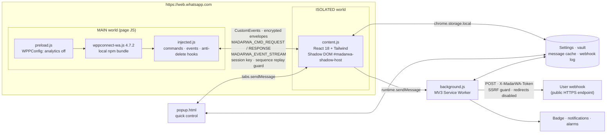
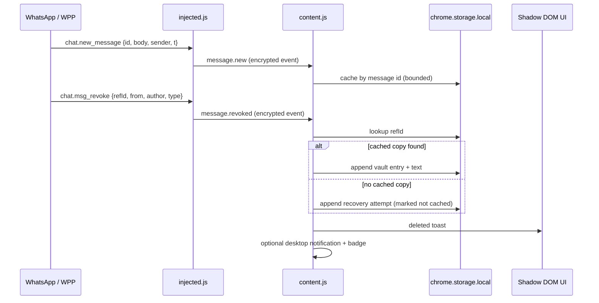

# MadarWA — مدار واتساب

**Enterprise privacy, CRM, anti-delete vault and smart broadcasting for WhatsApp Web.**
**Manifest V3 · TypeScript · React 18 · Tailwind · Local-only runtime.**

<p align="center">
  
  
  
  
  <a href="https://github.com/ALSRKAL/MadarWA/actions/workflows/ci.yml"></a>
  
</p>

> **العربية أولاً** — مدار واتساب إضافة Chrome مبنية على Manifest V3 تحوّل واتساب ويب إلى منصة خصوصية وأتمتة وإدارة عملاء، مع تشغيل محلي بالكامل: لا خادم وسيط، لا تتبّع، ولا كود بعيد. كل الواجهات ثنائية اللغة (العربية/الإنجليزية) ومصممة داخل Shadow DOM معزول حتى لا تتعارض مع أنماط واتساب.
>
> **English** — MadarWA is a Manifest V3 Chrome extension that turns WhatsApp Web into a privacy, CRM, automation and broadcasting workspace. Everything runs locally: no relay server, no telemetry, no remote code. The UI is fully bilingual (Arabic/English) and isolated inside a Shadow DOM.

---

## العربية

### المحتويات

- [نظرة عامة](#نظرة-عامة)
- [المزايا الكاملة](#المزايا-الكاملة)
- [المعمارية](#المعمارية)
- [دورة حياة الرسالة المحذوفة](#دورة-حياة-الرسالة-المحذوفة)
- [التثبيت](#التثبيت)
- [أوامر التطوير](#أوامر-التطوير)
- [الاختبارات والتحقق](#الاختبارات-والتحقق)
- [الخصوصية والأمان](#الخصوصية-والأمان)
- [الصلاحيات ومبرراتها](#الصلاحيات-ومبرراتها)
- [القيود المعروفة](#القيود-المعروفة)
- [استكشاف الأخطاء](#استكشاف-الأخطاء)
- [بنية المستودع](#بنية-المستودع)
- [المساهمة والترخيص](#المساهمة-والترخيص)

### نظرة عامة

MadarWA (مدار = Orbit) يضيف زر مدار إلى شريط واتساب ويب العلوي، ويفتح مركز تحكم منزلقاً داخل Shadow DOM معزول. يعتمد على حزمة `@wppconnect/wa-js` المضمّنة محلياً للوصول إلى واجهات واتساب الداخلية (`WPP`) بدلاً من الاعتماد على كشط DOM الهش. الجسر بين عالمَي التنفيذ مشفّر بمفتاح جلسة عابر ومحمي من إعادة التشغيل، والواجهة تعمل بالعربية RTL والإنجليزية LTR مع تبديل فوري.

- **بدون سيرفر خارجي:** الإعدادات والخزنة والسجلات كلها في `chrome.storage.local`.
- **بدون قيود CORS:** طلبات Webhook تتم من Service Worker.
- **بدون كود بعيد:** حزمة `wppconnect-wa.js` تُنسخ من `node_modules` إلى `dist/` وقت البناء.
- **بدون تتبّع:** يتم تعطيل تحليلات wa-js عبر `preload.js` قبل تحميلها.

### المزايا الكاملة

| الوحدة | ما تفعله فعلياً |
|---|---|
| **الخصوصية والتمويه** | تمويه معاينات القائمة، الأسماء، الصور، الرسائل والوسائط عبر `body[data-madarwa-*]` وحقن CSS. إظهار عند المرور فقط. إخفاء مؤشرات الاتصال والكتابة. إيقاف إيصالات القراءة و«آخر ظهور/متصل» عبر `WPP.privacy` الحقيقي، مع حفظ القيمة الأصلية لاستعادتها عند الإيقاف. |
| **قفل PIN** | قفل تلقائي بعد خمول قابل للضبط، رمز 4–8 أرقام مخزّن كـ PBKDF2-SHA256 (120,000 دورة + ملح عشوائي). لا يُحفظ الرمز نصاً أبداً. لوحة مفاتيح مدمجة ودعم لوحة المفاتيح. |
| **خزنة الرسائل المحذوفة** | التقاط كل رسالة جديدة وتخزينها بمفتاح `id`، ثم عند `chat.msg_revoke` استرجاع النص والمرسل والوقت من الذاكرة/التخزين. خزنة قابلة للبحث، فتح المحادثة، نسخ النص، تنبيه داخلي، إشعار سطح مكتب وعدّاد شارة. |
| **الإرسال الجماعي الذكي** | لصق أرقام أو رفع CSV/XLSX. تطبيع دولي (حذف `+` والمسافات والأصفار البادئة ودعم الأرقام العربية)، تحقق مسبق عبر `contact.queryWidExists`، متغيرات `{{name}}/{{custom1}}/{{custom2}}/{{phone}}`، Spintax، مرفقات حتى 4MB، تأخير عشوائي، دفعات وراحة، إيقاف/استئناف/إيقاف نهائي، سجل مباشر وتقرير CSV. |
| **الرد الآلي والقوالب** | قواعد Exact/Contains/StartsWith/Regex/Fallback، نطاق فردي/مجموعات/الكل، تهدئة لكل جهة اتصال، محاكاة كتابة، ومنع التكرار أثناء التنفيذ. قوالب رد سريع للإرسال أو الإدراج في حقل الكتابة. |
| **سحب الأرقام والمجموعات** | جلب المجموعات، أعضاء مجموعة (مع تمييز المشرفين)، جهات الاتصال المحفوظة، المحادثات. تصفية: استبعاد المشرفين، غير المحفوظين، مفتاح الدولة. تصدير CSV بترميز UTF-8 BOM (متوافق مع Excel العربي) أو JSON، مع حماية من حقن صيغ Excel. |
| **أدوات وWebhook** | فتح محادثة برقم غير محفوظ فوراً دون إعادة تحميل، إرسال رسالة أولى، تمرير الرسائل وأحداث الحذف إلى Webhook عبر Service Worker مع ترويسة `X-MadarWA-Token`، اختبار اتصال وسجل تسليم. |
| 🧭 **واجهة موحّدة** | 6 تبويبات، تبديل عربي/إنجليزي فوري، اتجاه RTL/LTR تلقائي، ثيم داكن/فاتح يتبع واتساب، زر عائم احتياطي إذا تغيّر DOM، ونافذة Popup سريعة. |

### المعمارية



**طبقات التنفيذ**

1. **MAIN World:** `preload.js` يضبط `WPPConfig` (تعطيل التحليلات واسم الجهاز `MadarWA`)، ثم `wppconnect-wa.js` المضمّن محلياً، ثم `injected.js` الذي ينتظر `WPP.loader.onReady` (مع دعم `WPP.webpack` القديم) ويسجّل أحداث `chat.new_message` و`chat.msg_revoke` و`chat.presence_change` ونظام الرد الآلي.
2. **ISOLATED World:** `content.js` يبني الواجهة بـ React داخل ShadowRoot مغلق الأنماط، ويدير الإعدادات والخزنة والوحدة والقفل ومدير الحملات، ويتواصل مع MAIN عبر جسر مشفّر.
3. **Service Worker:** `background.js` يرسل Webhooks، يحدّث الشارة، ينشئ الإشعارات، ويشغّل صيانة يومية عبر `chrome.alarms`.
4. **Popup:** حالة سريعة + فتح اللوحة + قفل + تبديل اللغة.

**الجسر بين العالمين**

- الجلسة تُنشأ من ISOLATED بمفتاح عشوائي 32 بايت و`sid` عشوائي.
- الأوامر والأحداث تُغلّف بمخطط `madarwa` ومفتاح جلسة وتوقيع FNV-1a داخلي ورقم تسلسل.
- MAIN يرفض أي تسلسل معادٍ أو جلسة مختلفة أو توقيع غير صالح.
- الجسر طبقة تقوية/عزل، وليس سرية مطلقة من كود الصفحة: كود MAIN جزء من صفحة الواتساب ويمكنه دائماً مراقبة حركته.

### دورة حياة الرسالة المحذوفة



> الخزنة تحتفظ بنسخة محلية من نص الرسائل. استخدمها فقط في السياقات التي تملك فيها الصلاحية والموافقة، ووفق القوانين المحلية.

### التثبيت

**المتطلبات:** Chrome 111+ (أو متصفح Chromium حديث يدعم `world: "MAIN"`)، Node.js 22.12+، npm 10+.

```bash
git clone https://github.com/ALSRKAL/MadarWA.git
cd MadarWA
npm install
npm run build
npm run verify
```

1. افتح `chrome://extensions`.
2. فعّل **Developer mode**.
3. اضغط **Load unpacked** واختر مجلد `dist/`.
4. افتح `https://web.whatsapp.com` وسجّل الدخول.
5. انتظر مؤشر المحرك الأخضر في اللوحة، ثم اضغط أيقونة المدار في الشريط العلوي (أو الزر العائم إن تعذّر حقن الشريط).
6. بعد أي تحديث للإضافة، أعد تحميل صفحة واتساب (Content scripts القديمة تصبح يتيمة).

**ملاحظة:** لا تفتح `dist/` من داخل مجلد المشروع قبل `npm run build`؛ المجلد يُنشأ بالبناء.

### أوامر التطوير

| الأمر | الوظيفة |
|---|---|
| `npm install` | تثبيت الاعتماديات |
| `npm run dev` | مراقبة `src/`, `public/`, `icons/`, `popup.html` وإعادة بناء `dist/` (بدون HMR؛ أعد تحميل الإضافة/الصفحة) |
| `npm run typecheck` | `tsc --noEmit` — صفر أخطاء |
| `npm test` | 68 اختبار Vitest |
| `npm run test:watch` | الاختبارات في وضع المراقبة |
| `npm run build` | بناء Popup + content + preload + injected + background ونسخ wa-js والأيقونات |
| `npm run verify` | 65 فحصاً هيكلياً على `dist/` |
| `npm run icons` | إعادة توليد أيقونات PNG 16/32/48/128 |
| `npm run clean` | حذف `dist/` |

### الاختبارات والتحقق

**68 اختباراً** في 9 ملفات:

| الاختبار | العدد | التغطية |
|---|---:|---|
| `bridge.test.ts` | 11 | تعمية/فك التعمية، توقيع العبث، منع إعادة التسلسل، المهلة، الأخطاء، الأحداث، رفض الأصل الأجنبي |
| `security.test.ts` | 10 | SSRF: localhost، IPv4/IPv6 الخاصة، العناوين العددية، `.local`، بيانات الاعتماد، ترويسة الرمز |
| `spintax-template.test.ts` | 10 | Spintax متداخل/هروب، الحفاظ على `{{...}}`، الاستيفاء، القيم التي تحتوي أقواساً |
| `phone-csv.test.ts` | 9 | تطبيع دولي/عربي، CSV مع فواصل وأسطر داخلية، رؤوس عربية، BOM، حقن الصيغ |
| `rules.test.ts` | 9 | Exact/Contains/StartsWith/Regex/Fallback، النطاق، التهدئة، Regex غير صالح |
| `queue.test.ts` | 6 | Jitter، الدفعات، Pause/Resume، Stop، الأخطاء، طابور فارغ |
| `defaults-i18n.test.ts` | 6 | تطهير الإعدادات، تطابق مفاتيح ar/en، القيم الافتراضية |
| `pin.test.ts` | 6 | PBKDF2، ملح فريد، رفض الرمز الخاطئ، صيغة الرمز |
| `ui-smoke.test.tsx` | 1 | تركيب اللوحة وعرض التبويبات الستة بالعربية والإنجليزية |

`node scripts/verify-build.mjs` يتحقق من:

- `manifest.json` صالح، Manifest V3، والإصدار يطابق `package.json`.
- كل ملف مذكور في المانيفست موجود وغير فارغ (بما فيها `wppconnect-wa.js` و`preload.js`).
- أبعاد كل أيقونة PNG صحيحة.
- ترتيب `preload.js` قبل حزمة wa-js.
- عدم وجود سكربت بعيد أو سكربت inline في `popup.html`.
- احتواء الحزم على نقاط التكامل الحقيقية: `chat.new_message`، `chat.msg_revoke`، `sendTextMessage`، Webhook، إلخ.
- عدم وجود `node_modules` داخل `dist/`.

**نتيجة البوابة الحالية:** `typecheck` ✅ · `68/68 tests` ✅ · `build` ✅ · `verify-build` ✅.

**تحقق حقيقي داخل المتصفح:** تم تحميل `dist/` كإضافة Unpacked في Chromium 156 على صفحة تسجيل الدخول في واتساب ويب. تأكدنا من تحميل `@wppconnect/wa-js 4.7.2` (`WPP.loader.isReady`)، واتصال محرك MAIN، ونجاح `engine.ping` عبر الجسر، وتركيب لوحة Shadow DOM، وتأثير مفتاح تمويه واحد على `body[data-madarwa-blur-preview]`، وتبديل AR/EN مع انعكاس `dir`. مسارات الإرسال والحذف التي تتطلب حساباً مسجلاً تحتاج اختباراً من حسابك.

### الخصوصية والأمان

- **لا خادم، لا تتبّع:** لا يوجد Analytics أو Telemetry. `preload.js` يضبط `disableGoogleAnalytics: true` قبل تحميل wa-js.
- **لا كود بعيد:** كل JavaScript محلي ومنتج بالبناء. CSP للإضافة: `script-src 'self'; object-src 'self'; base-uri 'none'`.
- **SSRF محمي:** قبل أي طلب Webhook أو اختبار، يتم رفض:
  - غير `http/https`، والبيانات المضمنة في الرابط.
  - `localhost`, `*.localhost`, `*.local`, `*.internal`, `.home.arpa`, `.test`, `.invalid`, `.example`, `metadata.google.internal`.
  - IPv4 خاصة/محجوزة: `0/8`, `10/8`, `100.64/10`, `127/8`, `169.254/16`, `172.16/12`, `192.168/16`, `192.0.0/24`, `198.18/15`, `198.51.100/24`, `203.0.113/24`, `224/4`, `240/4`.
  - IPv6: `::`, `::1`, `fc00::/7`, `fe80::/10`, multicast، `2001:db8::/32`, Teredo، 6to4، NAT64، والخرائط `::ffff:private`.
  - المنافذ 0، والأسماء أحادية التسمية.
  - تُعطّل إعادة التوجيه (`redirect: "error"`)، وتُرسل الطلبات بلا credentials، بمهلة 20 ثانية، وبحد حجم 512KB.
  - **تبقى مخاطرة DNS rebinding** غير قابلة للحل بالكامل داخل المتصفح؛ استخدم نطاقات عامة موثوقة.
- **رمز Webhook:** يُرسل في `X-MadarWA-Token`، ولا يُكتب في سجلات التسليم. التخزين محلي فقط.
- **PIN:** PBKDF2-SHA256، 120,000 دورة، ملح 16 بايت، مقارنة ثابتة الزمن. القفل واجهة استخدام وليس تشفيراً للقرص؛ من يملك DevTools/وصولاً للنظام يمكنه تجاوزه.
- **البيانات الحساسة:** نص الرسائل والأرقام تُخزّن محلياً في `chrome.storage.local` ضمن حدود قصوى. لا تُصدَّر إلا بطلب صريح منك.
- **تغييرات حساب واتساب:** إيقاف إيصالات القراءة/إخفاء الاتصال يعدّل إعدادات حسابك فعلياً على كل الأجهزة. راجع التنبيه داخل الواجهة.
- **محاكاة إيصالات الاستماع:** محاولة اعتراض عبر أغلفة WPP فقط، وقد لا تعمل على كل إصدار من واتساب؛ لا تُعتبر ضماناً.
- **مراجعة أمنية:** المشروع لم يخضع لتدقيق أمني خارجي. البناء مُتحقَّق منه هيكلياً ووظيفياً، وليس مُدقَّقاً أمنياً.

### الصلاحيات ومبرراتها

| الصلاحية | English justification | المبرر العربي |
|---|---|---|
| `storage` | Persist settings, vault, cache and logs locally. | حفظ الإعدادات والخزنة والكاش والسجلات محلياً. |
| `unlimitedStorage` | Allow a bounded but potentially large local message cache/vault. | السماح بكاش وخزنة محليين أكبر ضمن حدود قصوى. |
| `alarms` | Daily maintenance (cache/log trimming, badge refresh). | صيانة يومية: تقليم الكاش والسجلات وتحديث الشارة. |
| `notifications` | Optional desktop alerts for deleted messages. | إشعارات سطح مكتب اختيارية للرسائل المحذوفة. |
| `https://web.whatsapp.com/*` | Inject the engine and UI only on WhatsApp Web. | حقن المحرك والواجهة على واتساب ويب فقط. |
| `http://*/*`, `https://*/*` | Call arbitrary user-configured webhook endpoints (CORS bypass via service worker) and query WhatsApp tabs from the popup. | الاتصال بعناوين Webhook التي يحددها المستخدم (تجاوز CORS من Service Worker) والاستعلام عن تبويب واتساب من النافذة. |

لا تُطلب صلاحية `tabs`؛ الوصول للتبويب يتم عبر صلاحيات المضيف. يمكنك تضييق نطاق Webhook يدوياً في `public/manifest.json` إذا كان عنوانك معروفاً.

### القيود المعروفة

- واتساب يغيّر DOM ووحداته الداخلية بانتظام؛ محددات التمويه ومؤشرات الحضور قد تحتاج تحديثاً. وجود زر عائم احتياطي يضمن الوصول للوحة.
- إصدار `@wppconnect/wa-js` مثبّت على `4.7.2`؛ تحديث واتساب قد يتطلب تحديث الحزمة.
- الحملة لا تُستأنف بعد إعادة تحميل الصفحة (الطابور في الذاكرة)، والمرفقات لا تُحفظ في التخزين.
- حد المرفق 4MB بسبب حجم مظروف الجسر.
- التصفية النصية لمؤشرات الحضور تدعم العربية/الإنجليزية بشكل أساسي؛ اللغات الأخرى قد تحتاج توسيع الأنماط.
- الخزنة تحفظ حتى 1000 رسالة محذوفة (قابل للتغيير في الكود)، وكاش الرسائل حتى 3000.
- مزامنة LID → رقم هاتف تعتمد على واجهة wa-js وقد تفشل لبعض الحسابات.
- الإرسال الجماعي قد يعرّض الحساب لقيود واتساب؛ استخدم أرقام اختبار، تأخيرات عالية، ورسائل غير مزعجة.
- لا يمكن ضمان عمل الإضافة على إصدارات واتساب المستقبلية أو المتصفحات غير Chromium.

### استكشاف الأخطاء

| المشكلة | الحل |
|---|---|
| مؤشر المحرك أصفر/أحمر | أعد تحميل صفحة واتساب، تأكد من إغلاق إضافات مشابهة، وافتح DevTools لأن عالم MAIN قد يظهر خطأ `WPP_READY_TIMEOUT`. |
| الزر غير ظاهر في الهيدر | يجب أن يظهر الزر العائم بديلاً؛ إن لم يظهر فتأكد من تنشيط الإضافة وأن الصفحة `web.whatsapp.com`. |
| زر «فتح اللوحة» من Popup لا يعمل | أعد تحميل صفحة واتساب (Content script لم يُحقن قبل الإضافة). |
| Webhook يفشل | استخدم HTTPS عاماً، ليس localhost أو IP خاص، وتحقق من الرمز وسجل التسليم. |
| «تم إيقاف الحملة» بعد 3 إخفاقات | تعذّر الاتصال بالمحرك 3 مرات غالباً بعد إعادة تحميل الصفحة أو تسجيل الخروج. أعد التحميل وابدأ حملة جديدة. |
| نسيت PIN | القفل في ذاكرة الجلسة؛ إعادة تحميل صفحة واتساب تزيل القفل. يمكن أيضاً مسح تخزين الإضافة من `chrome://extensions` (يفقد الإعدادات والخزنة). القفل ليس حماية تشفيرية. |
| لا تظهر الرسائل المحذوفة | الخزنة تلتقط فقط بعد تفعيلها؛ قد تكون الرسالة أقدم من التفعيل أو الكاش. |
| واجهة مشوّهة | ثيم واتساب غيّر بنيته؛ أعد التحميل وأبلغ عن المحدد. الواجهة داخل Shadow DOM ولا تتأثر بأنماط الصفحة. |

### بنية المستودع

```text
MadarWA/
├── public/manifest.json          # MV3 manifest
├── popup.html                    # Popup entry
├── icons/                        # Generated PNG icons
├── src/
│   ├── background/index.ts       # Service worker: webhooks, badge, alarms
│   ├── content/
│   │   ├── index.tsx             # Shadow host + React mount
│   │   ├── controller.ts         # Settings, vault, cache, lock, bridge
│   │   ├── store.ts              # Zustand UI state
│   │   ├── broadcast.ts          # Campaign manager
│   │   ├── launcher.ts           # Header launcher + fallback
│   │   ├── privacy-runtime.ts    # CSS attributes + presence scrubber
│   │   ├── styles/shadow.css     # Tailwind + theme variables
│   │   └── ui/                   # App, LockScreen, Toasts, 6 tabs
│   ├── injected/
│   │   ├── preload.ts            # WPPConfig (analytics off)
│   │   ├── engine.ts             # MAIN-world controller
│   │   ├── wpp.ts                # Typed wa-js surface
│   │   ├── privacy.css           # Blur/hide rules
│   │   └── modules/              # privacy, exporter, autoreply
│   ├── popup/                    # Quick control popup
│   └── shared/
│       ├── bridge/               # Encrypted envelope + client/engine
│       ├── utils/                # phone, spintax, template, csv, rules, queue, security, pin
│       ├── defaults.ts
│       ├── i18n.ts
│       ├── storage.ts
│       └── types.ts
├── scripts/
│   ├── build.mjs                 # Multi-target Vite build
│   ├── generate-icons.mjs
│   └── verify-build.mjs
├── tests/                        # 68 Vitest tests
├── tailwind.config.js
├── vitest.config.ts
└── tsconfig.json
```

### المساهمة والترخيص

- الالتزام بـ **Conventional Commits**: `feat:`, `fix:`, `test:`, `chore:`, `refactor:`, `docs:`.
- قبل أي Commit: `npm run typecheck && npm test && npm run build && npm run verify`.
- لا تُضف كوداً بعيداً أو `eval`، ولا تكتب بيانات اعتماد حقيقية في المصدر أو الأمثلة أو الاختبارات.
- الترخيص: **MIT** — راجع [LICENSE](LICENSE).
- شكر خاص: WPPConnect/wa-js (Apache-2.0)، React، Vite، Tailwind CSS، i18next، Zustand، Lucide، read-excel-file.

---

## English

### Contents

- [Overview](#overview)
- [Complete feature set](#complete-feature-set)
- [Architecture](#architecture)
- [Deleted-message lifecycle](#deleted-message-lifecycle)
- [Installation](#installation)
- [Development commands](#development-commands)
- [Tests & verification](#tests--verification)
- [Privacy & security](#privacy--security)
- [Permissions & justifications](#permissions--justifications)
- [Known limitations](#known-limitations)
- [Troubleshooting](#troubleshooting)
- [Repository layout](#repository-layout)
- [Contributing & license](#contributing--license)

### Overview

MadarWA (“Orbit”) adds an orbit button to the WhatsApp Web top bar and opens a full control center inside an isolated Shadow DOM. It uses the locally bundled `@wppconnect/wa-js` library to access WhatsApp's internal `WPP` API instead of fragile DOM scraping. The two execution worlds communicate through an encrypted, session-scoped event bridge with replay protection. The UI is instantly switchable between Arabic RTL and English LTR.

- **No external server:** settings, vault, cache and logs live in `chrome.storage.local`.
- **No CORS wall:** webhooks are posted from the MV3 service worker.
- **No remote code:** `wppconnect-wa.js` is copied from `node_modules` into `dist/` at build time.
- **No telemetry:** wa-js analytics are disabled by `preload.js` before its bundle loads.

### Complete feature set

| Module | What it actually does |
|---|---|
| **Privacy & stealth** | Blur chat-list previews, names, avatars, messages and media using `body[data-madarwa-*]` CSS. Hover to reveal. Hide presence and typing indicators. Toggle real WhatsApp account privacy for read receipts and online visibility through `WPP.privacy`, restoring the captured original value when disabled. |
| **PIN lock** | Auto-lock after configurable idle time. 4–8 digit PIN stored as PBKDF2-SHA256 (120,000 iterations, random salt); plaintext is never persisted. Keypad + keyboard support. |
| **Anti-delete vault** | Caches every new message by ID, then on `chat.msg_revoke` recovers text, sender and timestamp from memory/storage. Searchable vault, open chat, copy text, in-chat toast, optional desktop notification and badge. |
| **Smart broadcaster** | Paste numbers or upload CSV/XLSX. International sanitizer (strips `+`, spaces, trunk zeros, supports Arabic-Indic digits), pre-validation with `contact.queryWidExists`, `{{name}}/{{custom1}}/{{custom2}}/{{phone}}` variables, Spintax, attachments up to 4MB, random jitter, batch cooldowns, start/pause/resume/stop, live logs and CSV report. |
| **Auto-reply & templates** | Exact/Contains/StartsWith/Regex/Fallback rules, private/groups/all scope, per-contact cooldown, typing simulation, in-flight dedupe. Quick templates can be sent to the active chat or inserted into the composer. |
| **Contacts & groups export** | Load groups, group participants (admins flagged), saved contacts and chats. Filters: exclude admins, unsaved only, country code. Export UTF-8 BOM CSV (Excel/Arabic friendly) or JSON, with spreadsheet formula-injection protection. |
| **Webhooks & tools** | Open a chat with an unsaved number instantly, optionally send a first message, forward messages/revocations to a webhook from the service worker with `X-MadarWA-Token`, test delivery and inspect a delivery log. |
| 🧭 **Unified UI** | Six tabs, instant AR/EN switch, automatic RTL/LTR, dark/light theme following WhatsApp, floating fallback launcher if the header DOM changes, and a quick popup. |

### Architecture


**Execution layers**

1. **MAIN world:** `preload.js` sets `WPPConfig` (analytics off, device name `MadarWA`), followed by the locally bundled `wppconnect-wa.js`, then `injected.js`. The engine waits for `WPP.loader.onReady` (with a legacy `WPP.webpack` fallback) and registers `chat.new_message`, `chat.msg_revoke` and `chat.presence_change`, plus the auto-reply engine.
2. **ISOLATED world:** `content.js` renders the React UI in a style-isolated ShadowRoot and owns settings, vault, cache, lock, campaign manager and bridge client.
3. **Service worker:** `background.js` posts webhooks, updates the badge, creates notifications and runs daily maintenance alarms.
4. **Popup:** quick status, open panel, lock and language switch.

**Bridge properties**

- Ephemeral 32-byte session key and random `sid`, created by ISOLATED.
- Envelopes carry a namespace, session ID, monotonic sequence, transport-obfuscated payload and keyed checksum.
- MAIN rejects wrong sessions, tampered payloads and replayed sequence numbers.
- This is transport hardening, not secrecy from page JavaScript: MAIN-world code is page code and can always observe its own traffic.

### Deleted-message lifecycle


> The vault stores local copies of message text. Use it only where you have authorization and consent, and in compliance with applicable law.

### Installation

**Requirements:** Chrome 111+ (or a recent Chromium browser supporting `world: "MAIN"`), Node.js 22.12+, npm 10+.

```bash
git clone https://github.com/ALSRKAL/MadarWA.git
cd MadarWA
npm install
npm run build
npm run verify
```

1. Open `chrome://extensions`.
2. Enable **Developer mode**.
3. Click **Load unpacked** and select `dist/`.
4. Open `https://web.whatsapp.com` and sign in.
5. Wait for the engine indicator to turn green, then click the orbit icon in the WhatsApp top bar (or the floating fallback button).
6. After updating the extension, reload the WhatsApp tab (old content scripts become orphaned).

### Development commands

| Command | Purpose |
|---|---|
| `npm install` | Install dependencies |
| `npm run dev` | Watch `src/`, `public/`, `icons/`, `popup.html` and rebuild `dist/` (no HMR; reload extension/page) |
| `npm run typecheck` | `tsc --noEmit` — zero errors |
| `npm test` | 68 Vitest tests |
| `npm run test:watch` | Watch tests |
| `npm run build` | Build popup + content + preload + injected + background, copy wa-js and icons |
| `npm run verify` | 65 structural assertions on `dist/` |
| `npm run icons` | Regenerate 16/32/48/128 PNG icons |
| `npm run clean` | Remove `dist/` |

### Tests & verification

**68 tests** across 9 files:

| Suite | Count | Coverage |
|---|---:|---|
| `bridge.test.ts` | 11 | Encode/decode, tamper detection, replay rejection, timeouts, error propagation, events, foreign-origin refusal |
| `security.test.ts` | 10 | SSRF: localhost, private IPv4/IPv6, numeric hosts, `.local`, credentials, token headers |
| `spintax-template.test.ts` | 10 | Nested/escaped spintax, protected `{{...}}`, interpolation, values containing braces |
| `phone-csv.test.ts` | 9 | International/Arabic normalization, quoted CSV with commas/newlines, Arabic headers, BOM, formula injection |
| `rules.test.ts` | 9 | Exact/Contains/StartsWith/Regex/Fallback, scope, cooldown, invalid regex |
| `queue.test.ts` | 6 | Jitter, batches, pause/resume, stop, failures, empty queue |
| `defaults-i18n.test.ts` | 6 | Settings sanitization, ar/en key parity, defaults |
| `pin.test.ts` | 6 | PBKDF2, unique salt, wrong PIN, format validation |
| `ui-smoke.test.tsx` | 1 | Mounts the dashboard and renders all six tabs in Arabic and English |

`node scripts/verify-build.mjs` asserts:

- Valid MV3 manifest and version parity with `package.json`.
- Every manifest-referenced file exists and is non-empty (including `wppconnect-wa.js` and `preload.js`).
- Correct PNG dimensions for every icon.
- `preload.js` runs before the wa-js bundle.
- No remote scripts and no inline scripts in `popup.html`.
- Bundles contain the real integration points (`chat.new_message`, `chat.msg_revoke`, `sendTextMessage`, webhooks, etc.).
- No `node_modules` inside `dist/`.

**Current gate:** `typecheck` ✅ · `68/68 tests` ✅ · `build` ✅ · `verify-build` ✅.

**Real browser smoke test:** `dist/` was loaded as an unpacked extension in Chromium 156 against the WhatsApp Web login page. Verified: local `@wppconnect/wa-js 4.7.2` loads (`WPP.loader.isReady`), the MAIN engine attaches, `engine.ping` succeeds over the bridge, the Shadow DOM dashboard mounts, a privacy switch applies `body[data-madarwa-blur-preview]`, and the AR/EN switch flips `dir`. Signed-in send/revoke flows still require testing with your own account.

### Privacy & security

- **No server, no telemetry.** `preload.js` sets `disableGoogleAnalytics: true` before wa-js loads.
- **No remote code.** All JavaScript is bundled locally. Extension CSP: `script-src 'self'; object-src 'self'; base-uri 'none'`.
- **SSRF-guarded webhooks.** Before every delivery/test, the service worker rejects:
  - non-HTTP(S) schemes and URLs containing credentials;
  - `localhost`, `*.localhost`, `*.local`, `*.internal`, `.home.arpa`, `.test`, `.invalid`, `.example`, `metadata.google.internal`;
  - private/reserved IPv4 ranges (`0/8`, `10/8`, `100.64/10`, `127/8`, `169.254/16`, `172.16/12`, `192.168/16`, `192.0.0/24`, `198.18/15`, `198.51.100/24`, `203.0.113/24`, `224/4`, `240/4`);
  - IPv6 loopback/unspecified, ULA, link-local, multicast, documentation, Teredo, 6to4, NAT64 and `::ffff:private` mappings;
  - port 0 and single-label intranet hostnames.
  - Requests disable redirects (`redirect: "error"`), omit credentials, time out after 20s and are capped at 512KB.
  - **DNS rebinding remains a residual risk** that cannot be fully solved in an extension. Use trusted public endpoints.
- **Webhook token** is sent as `X-MadarWA-Token` and never written to delivery logs.
- **PIN** uses PBKDF2-SHA256 with 120,000 iterations and a 16-byte salt, compared in constant time. The lock is a UI convenience, not disk encryption; anyone with DevTools/system access can bypass it.
- **Sensitive data.** Message text and phone numbers are stored locally in `chrome.storage.local` with hard caps. Nothing is exported without an explicit user action.
- **Account-level changes.** Disabling read receipts / online visibility changes the real WhatsApp account setting across devices. The UI warns before doing so.
- **Audio played receipt suppression** is a best-effort interception through WPP wrappers and may not work on every WhatsApp build.
- **Audit status.** This project has not undergone an external security audit. The build is structurally and functionally verified, not security-audited.

### Permissions & justifications

| Permission | English justification | Arabic justification |
|---|---|---|
| `storage` | Persist settings, vault, cache and logs locally. | حفظ الإعدادات والخزنة والكاش والسجلات محلياً. |
| `unlimitedStorage` | Allow a bounded but larger local cache/vault. | السماح بكاش وخزنة محليين أكبر ضمن حدود. |
| `alarms` | Daily cache/log trimming and badge refresh. | صيانة يومية وتحديث الشارة. |
| `notifications` | Optional desktop alerts for deleted messages. | إشعارات سطح مكتب اختيارية. |
| `https://web.whatsapp.com/*` | Inject the engine/UI only on WhatsApp Web. | حقن المحرك والواجهة على واتساب ويب فقط. |
| `http://*/*`, `https://*/*` | Call arbitrary user-configured webhook endpoints (CORS bypass via service worker) and query WhatsApp tabs from the popup. | الاتصال بعناوين Webhook يحددها المستخدم والاستعلام عن تبويب واتساب. |

No `tabs` permission is requested; host permissions cover the popup’s tab lookup. If your webhook host is fixed, narrow `host_permissions` in `public/manifest.json`.

### Known limitations

- WhatsApp changes its DOM and internal modules frequently; blur/presence selectors may need updates. The floating fallback keeps the dashboard reachable.
- `@wppconnect/wa-js` is pinned to `4.7.2`; a future WhatsApp build may require an upgrade.
- Campaigns do not resume after a page reload (in-memory queue), and attachments are not persisted.
- Attachments are capped at 4MB by the bridge envelope.
- Presence/typing text matching is Arabic/English-first; other locales may need pattern extensions.
- Vault keeps up to 1,000 deleted messages, message cache up to 3,000.
- LID → phone resolution depends on wa-js and may fail for some accounts.
- Bulk sending can trigger WhatsApp account restrictions. Use test numbers, high delays and non-spammy content.
- No guarantee of compatibility with future WhatsApp releases or non-Chromium browsers.

### Troubleshooting

| Symptom | Fix |
|---|---|
| Engine indicator amber/red | Reload WhatsApp, close conflicting extensions, check DevTools for `WPP_READY_TIMEOUT`. |
| Header button missing | The floating fallback should appear; ensure the extension is enabled and the tab is `web.whatsapp.com`. |
| Popup “Open dashboard” does nothing | Reload the WhatsApp tab; the content script is not injected until reload after install/update. |
| Webhook fails | Use a public HTTPS endpoint, not localhost/private IP; verify token and delivery log. |
| Campaign stops after three failures | The engine is unreachable after a reload/logout. Reload the page and start a new campaign. |
| Forgot PIN | The lock is page-session state; reloading WhatsApp clears it. Clearing extension storage also works but loses settings/vault. The lock is not cryptographic protection. |
| Deleted messages not captured | Capture only starts after enabling the vault; messages older than activation/cache limits are unavailable. |
| UI looks off | WhatsApp changed its DOM; reload and report the selector. The UI itself is Shadow-DOM isolated. |

### Repository layout

```text
MadarWA/
├── public/manifest.json          # MV3 manifest
├── popup.html                    # Popup entry
├── icons/                        # Generated PNG icons
├── src/
│   ├── background/index.ts       # Service worker: webhooks, badge, alarms
│   ├── content/
│   │   ├── index.tsx             # Shadow host + React mount
│   │   ├── controller.ts         # Settings, vault, cache, lock, bridge
│   │   ├── store.ts              # Zustand UI state
│   │   ├── broadcast.ts          # Campaign manager
│   │   ├── launcher.ts           # Header launcher + fallback
│   │   ├── privacy-runtime.ts    # CSS attributes + presence scrubber
│   │   ├── styles/shadow.css     # Tailwind + theme variables
│   │   └── ui/                   # App, LockScreen, Toasts, 6 tabs
│   ├── injected/
│   │   ├── preload.ts            # WPPConfig (analytics off)
│   │   ├── engine.ts             # MAIN-world controller
│   │   ├── wpp.ts                # Typed wa-js surface
│   │   ├── privacy.css           # Blur/hide rules
│   │   └── modules/              # privacy, exporter, autoreply
│   ├── popup/                    # Quick control popup
│   └── shared/
│       ├── bridge/               # Encrypted envelope + client/engine
│       ├── utils/                # phone, spintax, template, csv, rules, queue, security, pin
│       ├── defaults.ts
│       ├── i18n.ts
│       ├── storage.ts
│       └── types.ts
├── scripts/
│   ├── build.mjs                 # Multi-target Vite build
│   ├── generate-icons.mjs
│   └── verify-build.mjs
├── tests/                        # 68 Vitest tests
├── tailwind.config.js
├── vitest.config.ts
└── tsconfig.json
```

### Contributing & license

- Follow **Conventional Commits**: `feat:`, `fix:`, `test:`, `chore:`, `refactor:`, `docs:`.
- Before committing: `npm run typecheck && npm test && npm run build && npm run verify`.
- Never add remote code or `eval`, and never commit real credentials in source, examples or tests.
- License: **MIT** — see [LICENSE](LICENSE).
- Acknowledgements: WPPConnect/wa-js (Apache-2.0), React, Vite, Tailwind CSS, i18next, Zustand, Lucide, read-excel-file.

---

## Disclaimer / إخلاء المسؤولية

**English:** MadarWA is an independent, unofficial project and is not affiliated with or endorsed by WhatsApp or Meta. Automating WhatsApp Web may violate WhatsApp's Terms of Service and can lead to account restrictions. You are responsible for the content you send, the numbers you contact, and compliance with privacy and anti-spam laws (including consent requirements). Use the privacy, anti-delete and export features only on accounts and conversations you are authorized to manage. The software is provided “as is”, without warranty of any kind.

**العربية:** مدار واتساب مشروع مستقل وغير رسمي، غير تابع لواتساب أو Meta وغير معتمد منه. أتمتة واتساب ويب قد تخالف شروط الخدمة وقد تؤدي إلى قيود على الحساب. أنت مسؤول عن المحتوى الذي ترسله والأرقام التي تتواصل معها وعن الالتزام بقوانين الخصوصية ومكافحة الإزعاج (بما في ذلك الموافقة المسبقة). استخدم مزايا الخصوصية والخزنة والتصدير فقط على الحسابات والمحادثات المسموح لك بإدارتها. البرنامج يُقدَّم «كما هو» دون أي ضمانات.
